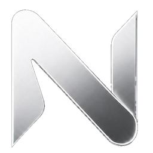

<h1 align="center">Nocturne Notes</h1>

<strong>Minimalist note editor</strong>

Windows 11 x64 · Open source

  
  
  

  
  
  
  
  
  

<a href="README.md">English</a> · <a href="README.ru.md">Русский</a>

  <a href="https://github.com/Chatonaut/Nocturne_Notes/releases/latest"><strong>Download</strong></a> ·
  <a href="docs/en/USER_GUIDE.md">User guide</a> ·
  <a href="docs/en/CHANGELOG.md">What's new</a> ·
  <a href="docs/en/00_START_HERE.md">Documentation</a> ·
  <a href="https://github.com/Chatonaut/Nocturne_Notes/issues">Feedback</a>

---

Nocturne Notes is a free, open-source desktop note editor for Windows 11. Organize rich-text notes in local project files, work offline and optionally protect projects with a password. No account or cloud service is required.

## Download

[Latest stable release](https://github.com/Chatonaut/Nocturne_Notes/releases/latest) · [Release history](https://github.com/Chatonaut/Nocturne_Notes/releases)

**System requirements:** Windows 11, x64. Both editions provide the same features.

| Setup | Portable |
|---|---|
| [Nocturne Notes Setup.exe](https://github.com/Chatonaut/Nocturne_Notes/releases/download/v2.5.0/Nocturne.Notes.Setup.exe) | [Nocturne Notes Portable.exe](https://github.com/Chatonaut/Nocturne_Notes/releases/download/v2.5.0/Nocturne.Notes.Portable.exe) |
| Per-user installation, selectable folder, shortcuts and .ns association | Run directly, without installation |
| Profile: `%APPDATA%/Nocturne Notes` | Separate profile: `%APPDATA%/Nocturne Notes Portable` |

Portable does not store its entire profile beside the executable. Verify downloads against the release's [SHA-256 checksums](https://github.com/Chatonaut/Nocturne_Notes/releases/download/v2.5.0/SHA256SUMS.txt). GitHub may replace spaces in filenames with dots; compare the hash values. The EXEs are unsigned and may trigger Windows SmartScreen. [Installation and verification guide](docs/en/USER_GUIDE.md).

## Features

- **Write:** rich-text formatting, adjustable typography, focus mode and always on top.
- **Organize:** multiple notes per project, pinned notes, drag-to-reorder, trash and restore.
- **Find:** search and replace in a note or throughout the project.
- **Protect:** optional SQLCipher project encryption, password management and quick manual lock.
- **Recover:** autosave, independent crash recovery, temporary drafts and session undo/redo.
- **Export:** TXT, HTML and Markdown.
- **Customize:** English/Russian interface, optional tray, spellcheck and editor settings.

Version 2.5 introduces project protection, temporary drafts and pinned notes, alongside search, recovery and reliability improvements. [Full changelog](docs/en/CHANGELOG.md).

## Screenshots

| Settings | Project protection |
|---|---|
|  |  |

[Locked project](https://github.com/Chatonaut/Nocturne_Notes/releases/download/v2.5.0/Nocturne-Notes-Locked.png). Screenshots show the application with sample notes. The 2.5.0 files and screenshots are available in the [2.5.0 release](https://github.com/Chatonaut/Nocturne_Notes/releases/tag/v2.5.0).

## Your data

Projects are local .ns database files. Ordinary projects use SQLite; password-protected projects use SQLCipher. Protection includes note titles, trash and recovery stored inside the protected database.

- Unprotected files, file names, clipboard contents, plaintext exports and earlier copies are not encrypted.
- There is no password reset or secure deletion. Minimizing or hiding in the tray does not automatically lock a project.
- Close the app before copying or backing up a project. Do not edit the same project in two processes.
- The default network test observed no application HTTP/WebSocket requests. Optional spelling dictionaries and external links are separate.

[Project format](docs/en/05_NS_FORMAT.md) · [Security limitations](docs/en/10_RISKS_AND_DECISIONS.md)

## Documentation

| For users | For developers |
|---|---|
| [User guide and keyboard shortcuts](docs/en/USER_GUIDE.md) | [Build from source](docs/en/06_BUILD_GITHUB.md) |
| [What's new](docs/en/CHANGELOG.md) | [Architecture](docs/en/04_ARCHITECTURE.md) |
| [All documentation](docs/en/00_START_HERE.md) | [Quality assurance](docs/en/07_QA_ACCEPTANCE.md) |

## Build and verification

Built with Electron, JavaScript, HTML/CSS and a native SQLCipher/OpenSSL module. The [Windows CI workflow](https://github.com/Chatonaut/Nocturne_Notes/actions/workflows/windows.yml) independently builds both editions and checks dependencies, application behavior, native runtime, packaging and installer. Audit results and software bills of materials (SBOMs) are generated during CI.

## Feedback

[Report a bug or suggest an improvement](https://github.com/Chatonaut/Nocturne_Notes/issues). Include the app version, Setup or Portable, Windows version, reproduction steps and expected versus actual behavior. Use sample data; do not attach personal notes, real project databases or passwords.

## License

[MIT](LICENSE). Third-party notices and applicable licenses are bundled with the Windows build.
