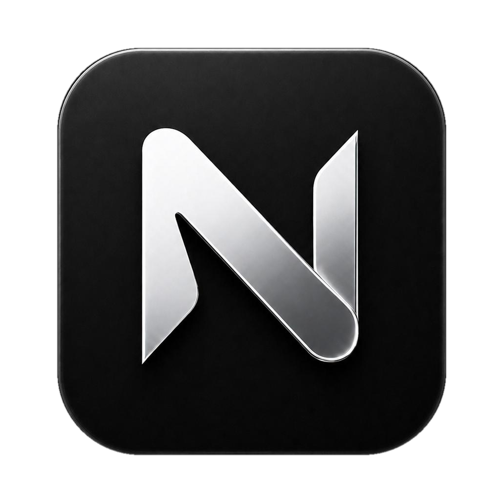

# Nocturne Notes

**Спокойное пространство для ваших мыслей.**

[English](README.md) · Русский

       

Минималистичный редактор заметок в темном стеклянном стиле для Windows 11. Пишите, упорядочивайте и форматируйте заметки в локальных проектах. Без аккаунта, облачного сервиса и подписки.

## Скачать

| Редакция | Файл |
|---|---|
| Установщик | [Nocturne Notes Setup 2.0.0.exe](https://github.com/Chatonaut/Nocturne_Notes/releases/tag/v2.0.0) |
| Portable | [Nocturne Notes Portable.exe](https://github.com/Chatonaut/Nocturne_Notes/releases/tag/v2.0.0) |
| Целостность | [SHA256SUMS.txt](https://github.com/Chatonaut/Nocturne_Notes/releases/download/v2.0.0/SHA256SUMS.txt) |

[Описание релиза и все загрузки](https://github.com/Chatonaut/Nocturne_Notes/releases/tag/v2.0.0). Windows 11 x64; EXE без цифровой подписи, Windows может предупредить об издателе. Portable не требует установки, но использует локальный профиль AppData.

## Возможности

- Компактный темный стеклянный интерфейс, прозрачные углы, изменяемая и скрываемая боковая панель.
- Несколько форматированных заметок в каждом локальном SQLite-проекте .ns; сортировка, дублирование, корзина и восстановление.
- Поиск и замена в заметке или проекте; экспорт TXT, HTML и Markdown.
- Автосохранение, восстановление после сбоя, сессионные Undo/Redo, семь системных шрифтов и настройка типографики.
- Концентрация, поверх окон и опциональное сворачивание в трей.
- Английский по умолчанию; полный русский интерфейс.

## Скриншоты

 

## Документация

[Руководство](docs/ru/USER_GUIDE.md) · [Карта документации](docs/ru/00_START_HERE.md) · [История изменений](docs/ru/CHANGELOG.md) · [Сборка](docs/ru/06_BUILD_GITHUB.md) · [Формат NS](docs/ru/05_NS_FORMAT.md)

## Конфиденциальность

Заметки хранятся локально, приложение их не шифрует. Нет аккаунтов и облачной синхронизации. Делайте копии закрытых файлов .ns; сессионный Undo не заменяет историю версий.

## Разработка

Node.js 22, Electron 45.4.1, обычный JavaScript, встроенный SQLite. Перед упаковкой ознакомьтесь с руководством сборки. Исходный код распространяется под [MIT](LICENSE).

